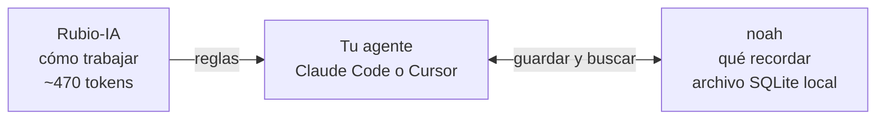

# Rubio-IA

Un acuerdo de trabajo corto para tu agente de código, en unos 470 tokens.

Rubio-IA escribe un bloque pequeño en las instrucciones globales de Claude Code y Cursor: ser directo, verificar antes de afirmar, dimensionar el trabajo, no tocar secretos y usar [noah](https://github.com/dicapower/noah) para la memoria si está instalado. No tiene personaje ni tono propio. Para cambios grandes o de riesgo añade una skill, `rubio-plan`: planificar, aprobar, construir, verificar.

Go, solo biblioteca estándar. Sin red, sin telemetría, sin cgo. Apache-2.0, DICA POWER OÜ. [English](README.md)

## noah y Rubio-IA: qué son y cómo encajan

Dos herramientas pequeñas con trabajos distintos. Funcionan mejor juntas, y cada una funciona sola.

| | noah | Rubio-IA |
|---|---|---|
| Qué es | Una memoria: un cuaderno en tu ordenador donde el agente guarda y busca | Un acuerdo de trabajo: un bloque corto en las instrucciones de tu agente |
| Responde a | "¿Qué decidimos la semana pasada?" | "¿Cómo debo trabajar aquí y cuándo uso mi memoria?" |
| Sin la otra | Funciona. El agente guarda cuando se le ocurre | Funciona. Sus reglas de memoria se ignoran y los planes van a `docs/plans/` |



Rubio-IA le dice al agente cuándo consultar y qué merece guardarse; noah lo conserva entre sesiones. Ninguna edita los archivos de la otra y ninguna usa la red.

## Inicio rápido (unos 3 minutos)

**1. Instala las dos.** macOS y Linux:

```sh
curl -fsSL https://raw.githubusercontent.com/dicapower/noah/main/install.sh | sh
curl -fsSL https://raw.githubusercontent.com/dicapower/rubio-ia/main/install.sh | sh
```

Windows (PowerShell, sin permisos de administrador):

```powershell
irm https://raw.githubusercontent.com/dicapower/noah/main/install.ps1 | iex
irm https://raw.githubusercontent.com/dicapower/rubio-ia/main/install.ps1 | iex
```

**2. Conecta noah a tu agente.** Claude Code: `claude mcp add noah --scope user -- noah mcp`. Cursor: ejecuta `noah setup` y sigue lo que imprime (nunca edita tu configuración).

**3. Añade el acuerdo de trabajo.** `rubio setup` (responde en el idioma en que escribes) o `rubio setup --lang es-ES` para español de España.

Abre una terminal nueva si no encuentra un comando, reinicia tu agente y comprueba con `noah doctor` y `rubio doctor`. Después, trabaja con normalidad: *"recuerda que usamos Firebase Auth para el login"*. Arrepentirse es seguro: `rubio remove` quita el acuerdo y cada cambio tiene copia de seguridad previa (`rubio restore`).

## Instalación

```sh
curl -fsSL https://raw.githubusercontent.com/dicapower/rubio-ia/main/install.sh | sh
```

Homebrew:

```sh
brew tap dicapower/rubio-ia https://github.com/dicapower/rubio-ia
brew install dicapower/rubio-ia/rubio
```

Windows sin Scoop (PowerShell):

```powershell
irm https://raw.githubusercontent.com/dicapower/rubio-ia/main/install.ps1 | iex
```

Scoop (Windows):

```sh
scoop bucket add rubio https://github.com/dicapower/rubio-ia
scoop install rubio
```

O descarga un archivo de las releases; las sumas están en `SHA256SUMS`.

## Uso

```sh
rubio setup --lang es-ES      # auto (por defecto), es-ES o en
rubio doctor                  # qué hay instalado y qué compite con ello
rubio setup --dry-run         # muestra los cambios sin hacerlos
rubio remove                  # quita Rubio-IA
rubio restore --list          # cada cambio tiene copia de seguridad previa
rubio restore [ID]            # deshace el último cambio, o el que indiques
```

Reinicia tu agente después de `setup` para que recargue las instrucciones.

## Qué escribe

| Dónde | Qué |
|---|---|
| `~/.claude/CLAUDE.md` | el núcleo, entre marcas `<!-- rubio-ia:core -->`; tu texto no se toca |
| `~/.cursor/rules/rubio-ia.mdc` | el mismo núcleo como regla siempre activa |
| `~/.claude/skills/rubio-plan/`, `~/.cursor/skills/rubio-plan/` | la skill de planificación (omítela con `--no-skills`) |
| `~/.rubio-ia/backups/` | los ficheros que `rubio` tocó, los últimos diez cambios |

Una skill con el mismo nombre que hayas escrito tú nunca se sobrescribe ni se elimina.

## rubio-plan

Lo pequeño se hace sin más. Lo mediano recibe un plan de cinco líneas como máximo. Lo grande o de riesgo sigue explorar, proponer (aprobarás antes de que se construya nada), especificar y tareas, aplicar, verificar. Los cambios de alto riesgo pasan por una revisión independiente con lista de hallazgos y una sola ronda de corrección como máximo. Las notas van a noah si está disponible; si no, a `docs/plans/<cambio>.md`.

## Si vienes de Gentle-AI

```sh
rubio doctor
rubio migrate gentle-ai            # muestra el plan, no cambia nada
rubio migrate gentle-ai --yes      # lo aplica, con copia de seguridad
```

Quita los bloques de Gentle-AI de `CLAUDE.md`, desactiva el estilo de salida Gentleman y borra su regla de Cursor. Con `--skills` elimina también las skills, agentes y comandos `sdd-*`; con `--plugins` desactiva el plugin de Engram. Tus otras skills se conservan. `~/.gentle-ai` no se toca; si contiene copias antiguas (pueden ocupar gigas e incluir historial de chats), `doctor` te dice el tamaño y decides tú.

## Límites

- Dos agentes por ahora: Claude Code y Cursor.
- No puede obligar a un agente a obedecer. Hace que las instrucciones sean lo bastante cortas para que se lean.
- La memoria necesita [noah](https://github.com/dicapower/noah); sin él esa sección se ignora.

## Desarrollo

```sh
go vet ./... && go test ./...
```

Un test mantiene el núcleo por debajo de 1.000 tokens y comprueba que solo nombra herramientas de noah que existen.
