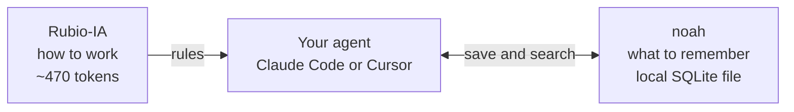

<p align="center">
  
</p>

# Rubio-IA

A short working agreement for your coding agent, in about 470 tokens.

Rubio-IA writes one small block into the global instructions of Claude Code and Cursor: be direct, verify before claiming, size the work, never touch secrets, and use [noah](https://github.com/dicapower/noah) for memory when it is installed. It has no persona and no tone of its own. For large or risky changes it adds one skill, `rubio-plan`: plan, approve, build, verify.

Go, standard library only. No network, no telemetry, no cgo. Apache-2.0, DICA POWER OÜ. [Español](README.es.md)

## noah and Rubio-IA: what they are and how they fit

Two small tools with different jobs. They work best together, and each works alone.

| | noah | Rubio-IA |
|---|---|---|
| What it is | A memory: a notebook on your computer that your agent saves to and searches | A working agreement: a short block in your agent's instructions |
| It answers | "What did we decide last week?" | "How should I work here, and when do I use my memory?" |
| Without the other | Works. The agent saves when it thinks of it | Works. Its memory rules are ignored and plans go to `docs/plans/` |



Rubio-IA tells the agent when to look things up and what is worth saving; noah keeps it between sessions. Neither edits the other's files, and neither uses the network.

## Quick start (about 3 minutes)

**1. Install both.** macOS and Linux:

```sh
curl -fsSL https://raw.githubusercontent.com/dicapower/noah/main/install.sh | sh
curl -fsSL https://raw.githubusercontent.com/dicapower/rubio-ia/main/install.sh | sh
```

Windows (PowerShell, no admin needed):

```powershell
irm https://raw.githubusercontent.com/dicapower/noah/main/install.ps1 | iex
irm https://raw.githubusercontent.com/dicapower/rubio-ia/main/install.ps1 | iex
```

**2. Connect noah to your agent.** Claude Code: `claude mcp add noah --scope user -- noah mcp`. Cursor: run `noah setup` and follow what it prints (it never edits your configuration).

**3. Add the working agreement.** `rubio setup` (answers in the language you write in) or `rubio setup --lang es-ES` for Spanish from Spain.

Open a new terminal if a command is not found, restart your agent, and check with `noah doctor` and `rubio doctor`. Then just work: *"remember that we use Firebase Auth for login"*. Changing your mind is safe: `rubio remove` takes the agreement out, and every change is backed up first (`rubio restore`).

## Install

```sh
curl -fsSL https://raw.githubusercontent.com/dicapower/rubio-ia/main/install.sh | sh
```

Homebrew:

```sh
brew tap dicapower/rubio-ia https://github.com/dicapower/rubio-ia
brew install dicapower/rubio-ia/rubio
```

Windows without Scoop (PowerShell):

```powershell
irm https://raw.githubusercontent.com/dicapower/rubio-ia/main/install.ps1 | iex
```

Scoop (Windows):

```sh
scoop bucket add rubio https://github.com/dicapower/rubio-ia
scoop install rubio
```

Or download a release archive; checksums are in `SHA256SUMS`.

## Use

```sh
rubio setup --lang es-ES      # auto (default), es-ES or en
rubio doctor                  # what is installed, and what competes with it
rubio setup --dry-run         # show the changes without making them
rubio remove                  # take Rubio-IA out again
rubio restore --list          # every change is backed up first
rubio restore [ID]            # undo the last change, or the one you name
```

Restart your agent after `setup` so it reloads its instructions.

## What it writes

| Where | What |
|---|---|
| `~/.claude/CLAUDE.md` | the core, inside `<!-- rubio-ia:core -->` markers; your own text is never touched |
| `~/.cursor/rules/rubio-ia.mdc` | the same core as an always-on rule |
| `~/.claude/skills/rubio-plan/`, `~/.cursor/skills/rubio-plan/` | the planning skill (skip it with `--no-skills`) |
| `~/.rubio-ia/backups/` | the files `rubio` touched, the last ten changes |

A skill with the same name that you wrote yourself is never overwritten or removed.

## rubio-plan

Small changes are just done. Medium ones get a plan of at most five lines. Large or risky ones follow explore, propose (you approve before anything is built), spec and tasks, apply, verify. High-risk changes get an independent review with a findings list and at most one correction round. Notes go to noah when available, otherwise to `docs/plans/<change>.md`.

## Coming from Gentle-AI

```sh
rubio doctor
rubio migrate gentle-ai            # prints the plan, changes nothing
rubio migrate gentle-ai --yes      # applies it, with a backup
```

It removes the Gentle-AI blocks from `CLAUDE.md`, unsets the Gentleman output style and deletes its Cursor rule. Add `--skills` to also remove the `sdd-*` skills, agents and commands, and `--plugins` to disable the Engram plugin. Your other skills stay. `~/.gentle-ai` is not touched; if it holds old backups (they can be gigabytes and include chat history), `doctor` tells you their size and you decide.

## Limits

- Two agents today: Claude Code and Cursor.
- It cannot make an agent obey. It makes the instructions short enough to be read.
- Memory needs [noah](https://github.com/dicapower/noah); without it that section is ignored.

## Brand

Logos, the shared social preview and the colour palette are described in [assets/BRAND.md](assets/BRAND.md).

## Development

```sh
go vet ./... && go test ./...
```

A test keeps the core under 1,000 tokens and checks that it only names noah tools that exist.
